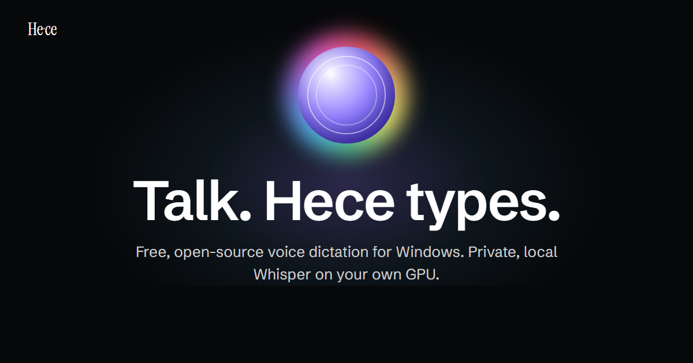

# Hece

Hold a hotkey, speak, and the text lands in the window you are typing in. Free, open-source voice
dictation for Windows, transcribed on your own GPU or by a cloud provider you pick.

**Website:** [altintasutku.github.io/hece](https://altintasutku.github.io/hece/)

<!-- DEMO: replace with the demo video (#58) -->

Status: early. Windows only for now; Linux and macOS are planned.

## Why Hece

- **Local first, offline.** Whisper runs on your NVIDIA GPU through CTranslate2. Once the model is
  downloaded, dictation needs no internet and your audio never leaves the PC. The model loads
  when you need it and is released when idle.
- **Many languages by default.** The default model is multilingual Whisper large-v3 turbo with
  automatic language detection. Fine-tuned single-language models (Turkish today) are one
  download away. Downloads are pinned to a revision and checked by sha256.
- **No phantom text.** On silence, plain Whisper writes lines like "Thanks for watching" or
  subtitle credits. Hece drops a segment when its whole text is such a line, and keeps the same
  words inside a real sentence.
- **Your "not" stays a "not".** Optional LLM cleanup removes fillers and fixes punctuation. A guard
  rejects any cleanup that drops a negation, adds lines or changes the length sharply, and Hece
  pastes the raw transcript instead.
- **Your vocabulary.** A list of names and terms, edited in Settings → Vocabulary or as a plain
  text file, steers transcription toward your spelling (Whisper prompt locally, key terms on
  Deepgram).
- **A confidence signal.** When the model was unsure, Hece still pastes the text but tells you it
  may be misheard. It never drops text on its own.
- **Cloud if you want.** No NVIDIA GPU? Use Groq, OpenAI, any OpenAI-compatible server, or
  Deepgram with your own key. Keys live in the Windows Credential Manager.
- **Stays out of the way.** One paste into the focused window, no key-by-key typing and no
  keyboard hooks. Your previous clipboard is restored, and transcripts stay out of Win+V history.

## Install (Windows)

1. Download `Hece_<version>_x64-setup.exe` from the
   [latest release](https://github.com/altintasutku/hece/releases/latest) and run it. It installs
   for the current user to `%LOCALAPPDATA%\Hece` (no administrator rights), adds **Hece** and
   **Hece Settings** to the Start menu, turns on autostart and opens the settings.

   <!-- UNSIGNED-BUILD NOTE: remove this block once code signing (#49) ships. -->
   > **Unsigned build.** The installer is not code-signed yet, so Windows SmartScreen may show
   > "Windows protected your PC". Choose **More info → Run anyway**. To check the file first,
   > compare it with `SHA256SUMS.txt` from the release, or verify that this repository's GitHub
   > Actions built it:
   > `gh attestation verify Hece_<version>_x64-setup.exe --repo altintasutku/hece`.
   > Signing is in progress ([#49](https://github.com/altintasutku/hece/issues/49),
   > [docs/code-signing.md](docs/code-signing.md)).
   <!-- /UNSIGNED-BUILD NOTE -->

2. For local transcription, download a model in **Hece Settings** or with `hece model download`
   (`hece model list` shows them): multilingual Whisper large-v3 turbo by default (about 1.6 GB),
   or a fine-tuned single-language model such as Turkish. Without an NVIDIA GPU, pick a cloud
   provider instead ([docs/cloud-providers.md](docs/cloud-providers.md)).
3. In **Hece Settings**, choose the downloaded model, or a cloud provider and its key. If Hece
   starts before this is set, it opens the settings window itself.
4. Start **Hece** from the Start menu. Hold **Ctrl+Shift+Space**, speak, let go. Both shortcuts
   can be changed in Settings → Shortcuts.

Uninstall from Windows Settings → Apps. Tick "Delete the application data" to also remove the
config, models, history, logs and stored API keys.

Build the installer yourself: `powershell -File scripts/build-release.ps1` (CUDA Toolkit 13.x,
plus the tools in `mise.toml`).

## Requirements

- Windows 10 or 11, 64-bit (tested on Windows 11).
- **Local transcription:** an NVIDIA GPU and a driver that supports CUDA 13. The release build is
  compiled for compute capability 8.9 and 12.0 (GeForce RTX 40 and RTX 50 series); other cards
  are untested. The installer does not include the CUDA runtime (cuBLAS, cudart): download it
  from NVIDIA once (~426 MB) in **Hece Settings** or with `hece runtime download`
  (`hece runtime status` checks it). An installed
  [CUDA Toolkit 13.x](https://developer.nvidia.com/cuda-downloads) on `PATH` is used as is.
- **Cloud transcription:** an API key for the provider, nothing else.

## Usage

| Action | How |
| --- | --- |
| Dictate | Hold **Ctrl+Shift+Space**, speak, let go. The text is pasted where your cursor is. |
| Toggle mode | Settings → Shortcuts → Recording mode **Toggle**: press once to start, once to stop. |
| Cancel | **Ctrl+Shift+Backspace** cancels the running recording or the dictation being transcribed. |
| Change shortcuts | Settings → Shortcuts: **Change**, then press the new chord. Or `[recording] hotkey` / `cancel_hotkey`. |
| Vocabulary | Settings → Vocabulary: add, edit, reorder (earlier wins) or import terms. |
| Paste again | Tray → **Paste last dictation** (or **Paste last raw transcript**), or `hece repaste [--raw]`. |
| History | `hece history` lists recent dictations; `hece history --clear` deletes them. |

The tray icon shows the state (idle, recording, transcribing) and has the menu: start or stop a
recording, paste the last dictation, settings, log folder, quit. Windows may tuck it under
"show hidden icons". While you record, an orb in the top-right corner follows your voice, and soft
sounds mark start, stop and cancel; both can be turned off in the settings. Long recordings are
transcribed in chunks while you are still speaking, so the text is ready soon after you stop.

## Providers

| Provider | Setup |
| --- | --- |
| Local Whisper (default) | NVIDIA GPU, a downloaded model |
| Groq, OpenAI | API key; OpenAI-compatible adapter |
| Any OpenAI-compatible server | `base_url`, model, optional key (speaches, whisper.cpp server, LocalAI) |
| Deepgram | API key |

A fallback provider can take over a dictation when the first one fails; a local provider falls
back to a cloud one only if you allow it. Step-by-step setup:
[docs/cloud-providers.md](docs/cloud-providers.md).

## Configuration

**Hece Settings** covers the common options and applies them without a restart. Everything lives
in `%APPDATA%\hece\config.toml` (`hece config` prints the path); the settings window keeps your
comments. If you edit the file by hand, restart Hece.

| Section | What it sets |
| --- | --- |
| `[recording]` | `mode` (hold or toggle), `hotkey`, `cancel_hotkey`, microphone `device`, `max_seconds` |
| `[transcription]` | `language` (default: auto-detect), `vocabulary_file` (default: `vocabulary.txt` next to `config.toml`), `allow_cloud_fallback` |
| `[provider]`, `[fallback]` | `kind` (local, openai, deepgram), model, `base_url`, `key` (keyring, none or `env:VARIABLE`) |
| `[cleanup]` | optional LLM cleanup: `anthropic` or `openai` kind (OpenAI, OpenRouter, Ollama, llama.cpp server) |
| `[api]` | local OpenAI-compatible API on `127.0.0.1`, off by default, token-protected (the token is in `%LOCALAPPDATA%\hece\api-token`; delete it and restart Hece to rotate it) |
| `[history]`, `[ui]`, `[feedback]`, `[updates]` | history size and age, overlay, sounds, update check |

The commented template written on first run is `TEMPLATE` in
[crates/hece/src/config.rs](crates/hece/src/config.rs).

## Privacy

- No account and no telemetry. With the local engine, audio and transcripts stay on your PC.
- With a cloud provider, the audio of each dictation and your vocabulary go to that provider, and
  with LLM cleanup the transcript goes to the cleanup provider.
- The only network call Hece makes on its own is a once-a-day check of GitHub's latest release
  (one GET, nothing about you is sent). Turn it off in Settings → About or with
  `[updates] check = false`.
- Audio, transcripts and API keys are never written to logs. Keys are stored in the Windows
  Credential Manager, never in `config.toml`.
- Pasted text never enters Win+V clipboard history or the cloud clipboard.
- Dictation history stays on your disk (`%LOCALAPPDATA%\hece`); cap it or turn it off with
  `[history]`.

## Commands

| Command | |
| --- | --- |
| `hece run` | the daemon in a console (`hecew` runs it without one) |
| `hece status`, `hece toggle` | ask or drive the running daemon |
| `hece history`, `hece repaste [--raw]` | recent dictations; copy the last one again |
| `hece model list\|download [id]` | local models |
| `hece runtime status\|download` | the CUDA runtime from NVIDIA |
| `hece key set\|delete <provider>` | API keys in the Credential Manager |
| `hece autostart on\|off\|status`, `hece config`, `hece devices` | setup |
| `hece dictate`, `hece bench` | one-off dictation; accuracy and latency benchmarks |

## Known limits

- Windows only. Local transcription needs an NVIDIA GPU (see Requirements).
- Opening the microphone takes 0.4–1.1 s on some devices (measured on a Realtek array); the tray
  turns red only when audio actually flows, so start speaking then.
- Pasting into a window running as administrator is blocked by Windows (UIPI) without an error;
  the text stays in `hece history`.
- The negation guard covers word-level negations in Turkish, English, Spanish, Portuguese, French,
  Italian, German, Dutch, Polish, Russian and Ukrainian; for other languages only its empty,
  line-break and length checks apply. Turkish verb negation (`-me/-ma`) is not detected.

## Roadmap

See the [roadmap issue (#70)](https://github.com/altintasutku/hece/issues/70). Linux support is
open for help: [#7](https://github.com/altintasutku/hece/issues/7) (help wanted).

## Contributing

Bug reports, ideas and pull requests are welcome. Read [CONTRIBUTING.md](CONTRIBUTING.md) for
prerequisites, the quality gate and PR expectations, [SECURITY.md](SECURITY.md) to report a
vulnerability privately, and the [Code of Conduct](CODE_OF_CONDUCT.md).

## Development

See [CONTRIBUTING.md](CONTRIBUTING.md) for the repository layout and build commands.

## License

[MIT](LICENSE). Third-party notices ship with the installer (`THIRD_PARTY_LICENSES.txt`).
